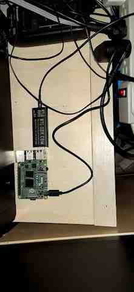
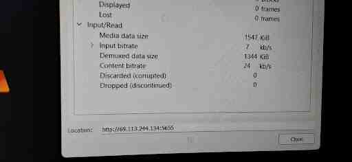
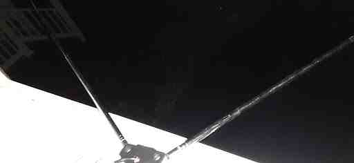
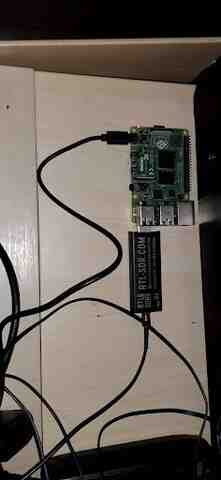
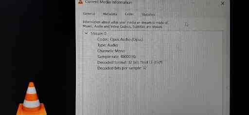
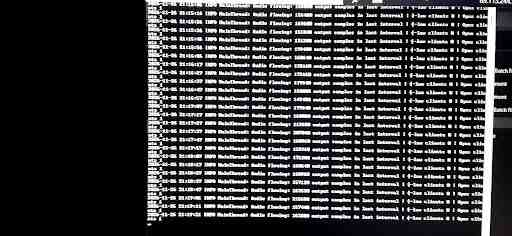
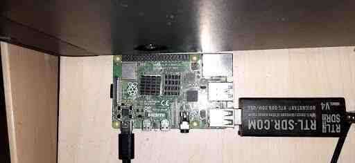

<h1>NOAA WX KWO35 Receiver</h1>
 

Opus 24 Kbps VBR: http://69.113.244.134:5655 (WeatherUSA Icecast Mirror: https://radio-master.weatherusa.net/NWR/KWO35_2.ogg)

μ-law PCM 128 kbps: tcp://69.113.244.134:5650

 
<h2>Hardware:</h2>

Raspberry PI 4 Model B 2GB RAM

Dell Optiplex 9020 MT (16 GB RAM, 4TB RAID, Intel Core i7-4770

RTL-SDR Blog v4 USB Dongle

300 Mbps Internet Connection

Stock RTL-SDR Kit Rabbit Ear Antenna (Extended to full length pointed toward NYC)

TP-Link Switch TL-SG605

<b>
<h2>Software:</h2>

Python3

Windows 11 Pro

Raspberry Pi OS Bookworm ARM64

FFmpeg

 
 

 

 

 

 

 

 

